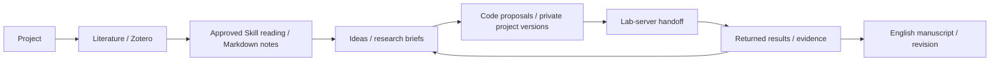

# ResearchOS — Personal Research Workspace

A self-hosted research planning, literature, ideas, writing and repository workspace. **One owner per installation**, with your own data and accounts.

**源码 / Source:** [GitHub](https://github.com/liujm03/researchos-public) · **下载 / Download:** [Releases](https://github.com/liujm03/researchos-public/releases) · **安装 / Install:** [INSTALL.md](INSTALL.md)

> This is a blank source distribution, not a preconfigured executable. No original-owner accounts, papers, notes, database, credentials or Git history are included. Docker/Python/Node dependencies and optional service authentication must be installed/configured by each user. The current UI and detailed user guide are Chinese.

## Quick start / 快速开始

1. Download the release ZIP and extract into a new directory, or clone this repository.
2. Install Docker Desktop/Compose and start its Linux engine. Python3.12 can generate the initial private configuration:

```bash
python scripts/initialize_blank.py --mode compose
docker compose up -d --build
```

3. Open **http://127.0.0.1:3100** after the API is ready. Read `INITIAL_SETUP_TOKEN` from **your own local `.env`**, then register your own first account. Never upload or share `.env`.
4. Follow [INSTALL.md](INSTALL.md) for Windows native deployment with your own Zotero/Codex, paper-reading Skill/template, GitHub integration, backups and recovery.

Initial users/papers/projects are empty; external integrations are disabled by default. Research experiments/training/evaluation/simulation belong on lab servers; this application manages planning/materials and bounded code improvements locally.

## Research workflow



## Validation and limitations

See [VALIDATION.md](VALIDATION.md): source/package checks, empty PostgreSQL migration/first-owner registration and Chrome empty-dashboard acceptance are documented. Fresh installation on every user machine and optional external integrations are not claimed as already tested.

## License

[MIT](LICENSE). Third-party dependencies and separately installed research materials retain their own terms; see [THIRD_PARTY_NOTICES.md](THIRD_PARTY_NOTICES.md).

---

# ResearchOS 空白独立安装版

这是一套完整应用的**无用户数据源码安装包**，不是已配置的便携软件。
每份安装只注册一位自己的所有者；没有预置用户、论文、课题、笔记或示例数据。
先阅读 [INSTALL.md](INSTALL.md)。

## 包含什么

FastAPI、Next.js、数据库迁移、文献/笔记/课题/灵感/任务/写作功能源码，
空白配置、依赖声明、启动入口、桌面按钮安装脚本与基础软件测试。

不包含原作者的数据库、账号、PDF、笔记、项目、壁纸、Git历史、运行库、
安装好的依赖、付费资料、第三方Skills或私人投稿模板。
依赖需要接收者自己安装；AI/Zotero/GitHub默认关闭，配置自己的账户后按需启用。

## 使用边界

文献与笔记可按多个研究课题归类；Zotero库/完整文件夹路径作为独立来源显示。
笔记可以独立分类、继承父修订或沿用论文，显式未分类不回退。课题任务书/证据按有效笔记分类选源。

- 每个人使用自己的安装目录、数据库和配置；不是共享原作者的私人实例。
- 科研实验、训练、评价、模型运行和仿真交给实验室服务器，本地只策划/阅读/改代码/整理资料。
- 文献导入不自动精读；选定原PDF、自己的Skill/模板和保存目录，批准后才调用AI。
- 平台是软件工具，自动结构检查不代表科学结论已经验证。
- 每个科研项目独立私有仓库，代码推送不能代替数据备份。

## 日常入口

`start_researchos.cmd` 开启；`check_researchos.cmd` 检查；`stop_researchos.cmd` 停止。
`open_researchos_guide.cmd` 打开本指南。第一次需先完成配置和依赖安装。
默认采用Docker基础部署；同机Zotero/Codex精读推荐INSTALL.md中的Windows本机部署。

## 校验和维护

发行包的 `RELEASE_MANIFEST.json` 含逐文件SHA-256，可用
`python scripts/verify_blank_package.py` 校验源码是否完整；校验不会连接外部服务。
文件修改后校验不再匹配原发行包是正常现象，应建立自己的版本记录。
AI维护者先读AGENTS.md、AI_HANDOFF.md及架构/API/数据库说明。

本项目源码与文档采用 [MIT License](LICENSE)，允许使用、修改、再分发和商用，须保留版权与许可声明。
第三方依赖遵循各自许可证；专业Skills、模型/数据和投稿模板由本人依法取得并配置。
